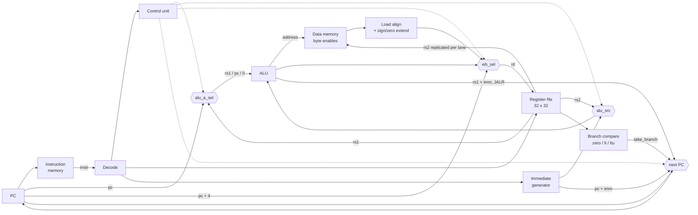

# RISC-V CPU

Single-cycle RV32I processor written from scratch in SystemVerilog. Simulation only (Vivado XSim).

Every module was built and verified on its own with a self-checking testbench before being wired into the CPU, and the CPU itself is verified by running real RV32I programs and checking register and memory state.

## Datapath



## Status

### Instructions

All 37 RV32I base instructions run on the single-cycle core (FENCE, ECALL and EBREAK are not implemented).
Encodings, behaviour and control signals for each one: [`docs/rv32i_reference.pdf`](docs/rv32i_reference.pdf).

| Group | Instructions | Verified by |
|---|---|---|
| R-type | ADD, SUB, AND, OR, XOR, SLL, SRL, SRA, SLT, SLTU | `tb_cpu`, `tb_alu_self` |
| I-type ALU | ADDI, ANDI, ORI, XORI, SLLI, SRLI, SRAI, SLTI, SLTIU | `tb_cpu` |
| Loads | LB, LH, LW, LBU, LHU | `tb_cpu_ldst`, `tb_cpu_mem` |
| Stores | SB, SH, SW (byte enables + lane replication) | `tb_cpu_ldst`, `tb_cpu_mem` |
| Branches | BEQ, BNE, BLT, BGE, BLTU, BGEU | `tb_cpu_sum`, `tb_cpu_br` |
| Jumps | JAL, JALR | `tb_cpu_call`, `tb_cpu_sort` |
| Upper immediate | LUI, AUIPC | `tb_cpu_br` |
| Full program | bubble sort: nested loops, signed compare, call / return | `tb_cpu_sort` |

Full regression: `.\run_all` runs 14 self-checking testbenches, 7,802 checks, all passing.

### Verified building blocks

Each block has a self-checking testbench (random + corner cases, independent reference model):

| Module | Description | Tests |
|---|---|---|
| `alu` | 10 operations + `zero` flag | 5,490 |
| `regfile` | 32 x 32-bit, 2 read / 1 write ports, `x0` hardwired to 0 | 534 |
| `pc` | Program counter, synchronous reset | 13 |
| `imem` | Instruction memory (ROM), loaded from a hex file | 5 |
| `dmem` | Data memory, byte-enable writes, little-endian | 505 |
| `immgen` | Immediate generator for I/S/B/U/J formats | 1,200 |
| `control` | Main decoder: ALU op, operand/write-back select, memory and PC control | 13 |

CPU-level tests run a program and check the final register file and data memory:

| Testbench | Program | What it checks |
|---|---|---|
| `tb_cpu` | `test_ri.hex` | R/I arithmetic end to end (8) |
| `tb_cpu_mem` | `test_mem.s` | LW / SW (4) |
| `tb_cpu_ldst` | `test_ldst.s` | every load/store width, sign/zero extension, partial-word writes (7) |
| `tb_cpu_sum` | `sum.hex` | BNE loop summing 1..5, result stored to memory (5) |
| `tb_cpu_call` | `test_call.s` | JAL into a function, JALR return, skipped instruction never runs (5) |
| `tb_cpu_br` | `test_br.s` | BLT / BLTU / BGE / BGEU with -1 vs 8 (signed and unsigned disagree), LUI, AUIPC (7) |
| `tb_cpu_sort` | `test_sort.s` | bubble sort of {5, -3, 9, 0} in memory, called as a function (6) |

## Tools

- **`rvasm.py`**: a small RV32I assembler written for this project. Supports all base instructions, labels, ABI register names and common pseudo-instructions (`li`, `mv`, `j`, `ret`, `beqz`, ...). Output is a commented hex file ready for `$readmemh`.

  ```
  python rvasm.py programs/test_ldst.s        # writes programs/test_ldst.hex
  python rvasm.py -e "SW x5, 4(x6)"           # encode a single line
  ```

- **`sim.bat`**: compiles all packages and modules, then elaborates and runs one testbench in XSim.

- **[`docs/rv32i_reference.pdf`](docs/rv32i_reference.pdf)**: instruction reference for this core: encodings, behaviour, control signals per opcode and machine-code examples. Regenerate after changing the control unit with `python docs/make_isa_ref.py` (needs Chrome or Edge).

## Layout

```
rtl/        design (rtl/pkg/ compiled first)
tb/         testbenches (tb_<name>.sv)
programs/   assembly sources (.s) and hex programs
docs/       instruction reference (PDF + generator)
rvasm.py    assembler
```

## Run

```
.\sim <name>      # runs tb\tb_<name>.sv, e.g. .\sim cpu_ldst
.\run_all         # runs every tb\tb_*.sv, summary in regression.txt
```

## Roadmap

1. ~~Complete single-cycle core: all branches, LUI, AUIPC~~ ✅ done (Nov 2026)
2. 5-stage pipeline: forwarding, load-use stall, flush
3. Verification against `riscv-tests` and a reference model
4. C toolchain: run a compiled Hello World over a UART peripheral