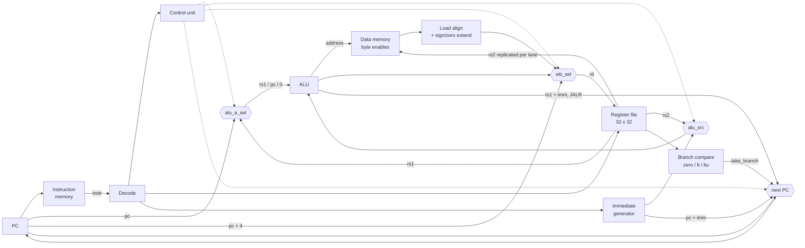

# RISC-V CPU

RV32I processor written from scratch in SystemVerilog, in two versions:

- **`cpu`**: single-cycle core, all 37 base instructions (tag `v1-single-cycle`).
- **`cpu_pipe`**: 5-stage pipeline (IF, ID, EX, MEM, WB) with forwarding, a WB→ID bypass, a load-use hazard unit and flush on taken branches / jumps. All hazards are handled in hardware: programs need no NOPs.

Simulated in Vivado XSim, and both cores are built for the Basys 3 board (Artix-7 `xc7a35tcpg236-1`) through place & route and timing: see [FPGA](#fpga-basys-3).

Every module was built and verified on its own with a self-checking testbench before being wired into the CPU, and both cores are verified by running real RV32I programs and checking register and memory state. **Both cores pass all 40 official `riscv-tests` rv32ui tests** (see [Verification](#verification)).

## Single-cycle datapath



## Status

### Instructions

All 37 RV32I base instructions run on the single-cycle core (FENCE, ECALL and EBREAK are not implemented).
Encodings, behaviour and control signals for each one: [`docs/rv32i_reference.pdf`](docs/rv32i_reference.pdf).

| Group | Instructions | Verified by |
|---|---|---|
| R-type | ADD, SUB, AND, OR, XOR, SLL, SRL, SRA, SLT, SLTU | `tb_cpu`, `tb_alu_self` |
| I-type ALU | ADDI, ANDI, ORI, XORI, SLLI, SRLI, SRAI, SLTI, SLTIU | `tb_cpu` |
| Loads | LB, LH, LW, LBU, LHU | `tb_cpu_ldst`, `tb_cpu_mem` |
| Stores | SB, SH, SW (byte enables + lane replication) | `tb_cpu_ldst`, `tb_cpu_mem` |
| Branches | BEQ, BNE, BLT, BGE, BLTU, BGEU | `tb_cpu_sum`, `tb_cpu_br` |
| Jumps | JAL, JALR | `tb_cpu_call`, `tb_cpu_sort` |
| Upper immediate | LUI, AUIPC | `tb_cpu_br` |
| Full program | bubble sort: nested loops, signed compare, call / return | `tb_cpu_sort` |

Full regression: `.\run_all` runs 22 self-checking testbenches, 7,983 checks, all passing.

### Pipeline

`rtl/cpu_pipe.sv` splits the same datapath into five stages. Each pipeline register is a `struct packed` "card" (`rtl/pkg/pipe_pkg.sv`) that carries everything the instruction still needs, including its own `pc`, `rd` and control bits.
Stages, cards, hazards and the real forwarding / stall code: [`docs/pipeline_reference.pdf`](docs/pipeline_reference.pdf).

| Hazard | Solution | Cost | Verified by |
|---|---|---|---|
| Structural | Harvard memories, separate regfile ports | 0 | all |
| Data (read after write) | forwarding from EX/MEM and MEM/WB, WB→ID bypass | 0 | `tb_cpu_pipe_c` |
| Load-use | hazard unit: hold PC and IF/ID, bubble into ID/EX | 1 cycle | `tb_cpu_pipe_d` |
| Control | predict not-taken; flush IF/ID and ID/EX on taken branch / jump | 2 cycles per taken jump | `tb_cpu_pipe_e` |

| Testbench | Program | What it checks |
|---|---|---|
| `tb_cpu_pipe_a` | `test_pipe_a.s` | IF/ID and ID/EX card contents, cycle by cycle (22) |
| `tb_cpu_pipe_b` | `test_pipe_b.s` | full 5 stages: ALU, loads/stores, call/return, branch (13) |
| `tb_cpu_pipe_c` | `test_pipe_c.s` | back-to-back dependencies, newest-write priority, bypass, x0 (13) |
| `tb_cpu_pipe_d` | `test_pipe_d.s` | load right before its use (ALU, store data, branch), exactly 4 stalls (14) |
| `tb_cpu_pipe_e` | `test_pipe_e.s` | no NOPs after jumps: wrong-path code never runs, a wrong-path jump never redirects, load-use + branch, exactly 5 flushes (15) |
| `tb_cpu_pipe_sort` | `test_sort.s` | the single-cycle bubble sort unchanged (no NOPs) on the pipeline: same results, 9 stalls, 24 flushes (8) |

Cycles on the bubble sort (101 instructions):

| | Single-cycle | Pipeline |
|---|---|---|
| Cycles | 101 | 161 (9 stalls, 24 flushes) |
| CPI | 1 | 1.59 |

Flushes are 79% of the extra cycles. Moving `j++` between the `LW` and its `BGE` (instruction scheduling) removes all 9 stalls: 152 cycles, CPI 1.50. On paper (8 ns per stage) this made the pipeline ×2.5 faster; on the FPGA it is not, see below.

### Verified building blocks

Each block has a self-checking testbench (random + corner cases, independent reference model):

| Module | Description | Tests |
|---|---|---|
| `alu` | 10 operations + `zero` flag | 5,490 |
| `regfile` | 32 x 32-bit, 2 read + 1 debug read / 1 write ports, `x0` hardwired to 0 | 534 |
| `pc` | Program counter, synchronous reset | 13 |
| `imem` | Instruction memory (ROM, 1024 words), loaded from a hex file | 5 |
| `dmem` | Data memory, byte-enable writes, little-endian | 505 |
| `immgen` | Immediate generator for I/S/B/U/J formats | 1,200 |
| `control` | Main decoder: ALU op, operand/write-back select, memory and PC control | 13 |

CPU-level tests run a program and check the final register file and data memory:

| Testbench | Program | What it checks |
|---|---|---|
| `tb_cpu` | `test_ri.hex` | R/I arithmetic end to end (8) |
| `tb_cpu_mem` | `test_mem.s` | LW / SW (4) |
| `tb_cpu_ldst` | `test_ldst.s` | every load/store width, sign/zero extension, partial-word writes (7) |
| `tb_cpu_sum` | `sum.hex` | BNE loop summing 1..5, result stored to memory (5) |
| `tb_cpu_call` | `test_call.s` | JAL into a function, JALR return, skipped instruction never runs (5) |
| `tb_cpu_br` | `test_br.s` | BLT / BLTU / BGE / BGEU with -1 vs 8 (signed and unsigned disagree), LUI, AUIPC (7) |
| `tb_cpu_sort` | `test_sort.s` | bubble sort of {5, -3, 9, 0} in memory, called as a function (6) |

## Verification

Four layers, from the inside out:

| Layer | What | Catches |
|---|---|---|
| Unit testbenches | every block against an independent model, random + corner cases | a wrong block |
| Program testbenches | `tb_cpu_*`, `tb_cpu_pipe_*`: real programs, registers / memory / pipeline cards checked | wrong wiring, wrong timing |
| Assertions | rules checked every cycle inside `cpu_pipe` (simulation only) | a rule broken mid-run, even if the final result looks right |
| Official tests | `riscv-tests` rv32ui on both cores | a misread of the ISA spec (tests written by someone else) |

**Assertions** (`cpu_pipe.sv`, inside `` `ifndef SYNTHESIS ``, so they add no hardware): a store never writes a register, `stall` and `flush` are never active together, every PC is 4-byte aligned (`imem` ignores `addr[1:0]`, so a misaligned jump would otherwise fail silently), and `reg_we` is never `x` after reset (an unconnected wire). A failing assertion prints `FAILED: assertion <name>, pc = ...` and stops, so `run_all` marks the test FAIL. Re-adding an old bug (`reg_we = 1` for stores) passes `tb_cpu_mem` but stops `tb_cpu_pipe_b` at the first store.

**Signature tests** (`tb_cpu_sig`, `programs/test_sig.s`): the program stores its results to a fixed area (8 words at 0x200) and writes 1 to `tohost` (0x3FC) when done. The testbench knows nothing about the program: it runs `cpu` and `cpu_pipe` side by side, waits for `tohost`, dumps both signatures to files (`$writememh`) and compares them with `test_sig.ref`. Because the pipeline is in order, the `tohost` store is always the last write.

**`riscv-tests`** (`tb_rvtests`, [`rvtests/`](rvtests/)): the 40 rv32ui tests (all except `fence_i` and `ma_data`), compiled with a minimal environment of our own (no CSRs: pass writes 1 to `tohost`, fail writes the failing test case number). One simulation loads each test into both cores in turn and checks `tohost`: **80 / 80 pass**.

**Reference model** (`refmodel.py`, in progress): an instruction-set simulator in Python, one instruction at a time with no timing, used to produce expected results for any program. Done so far: sign extension, field decode, the five immediate formats and the ALU, each with its own self-test.

## FPGA (Basys 3)

`fpga/top_basys3.sv` wraps either core (`PIPE` parameter) for the board: an `MMCME2_BASE` turns the 100 MHz oscillator into the CPU clock (1000 / `CLK_DIV` MHz, default 66.7 MHz), a 2-FF synchronizer with power-on reset drives `rst` (center button), and a third, debug read port of the register file shows any register on the 16 LEDs (`sw[4:0]` = register number, `sw[15]` = upper half). The program (`test_sort.hex` by default) is loaded into `imem` at synthesis.

```
cd build
vivado -mode batch -nojournal -nolog -source ..\fpga\build.tcl -tclargs 1 10 > build_pipe.log      # cpu_pipe, CLK_DIV = 10
vivado -mode batch -nojournal -nolog -source ..\fpga\build.tcl -tclargs 0 10 > build_single.log    # cpu
vivado -mode batch -nojournal -nolog -source ..\fpga\program.tcl -tclargs top_pipe.bit > program.log
```

`build.tcl` runs synthesis, place & route, utilization and timing reports and the bitstream, and prints `period`, `WNS` and `Fmax`. Fmax is measured with a deliberately too-fast clock (`CLK_DIV = 10`, 100 MHz), so the router works hard and the negative slack shows the real limit. Both cores meet timing at the default 66.7 MHz.

| | Single-cycle `cpu` | Pipeline `cpu_pipe` |
|---|---|---|
| Fmax | **94.4 MHz** | 90.5 MHz (81.3 before the fanout fixes) |
| Slice LUTs | 589 | 1,062 |
| LUT as memory (regfile + dmem) | 194 | 194 |
| Flip-flops | 34 | 449 |
| CPI on bubble sort | 1 | 1.59 |
| Bubble sort time | **1.07 µs** | 1.78 µs |

**The single-cycle core wins: the pipeline is 1.66× slower.** To break even it would need 94.4 × 1.59 ≈ 150 MHz. The textbook ×4 assumes balanced stages and slow memories. Here every memory is distributed LUTRAM with an asynchronous read of about 1 ns, and `imem` is a small ROM, so the whole single-cycle path (`pc` → `imem` → regfile → compare → `pc_next`, 14 logic levels) fits in 10.4 ns. The pipeline's EX stage alone (forwarding compare → forward MUX → 32-bit compare → `take_branch` → `flush`) is about as long, and 80% of it is routing. With synchronous BRAM memories, as in a real CPU, the single-cycle design could not fetch and execute in one cycle and the pipeline would win.

Timing closure on the pipeline, one critical path at a time:

| Step | Fmax | Critical path ended at |
|---|---|---|
| Start: flush / stall reset whole cards | 81.3 MHz | `id_ex[...]/R`: `flush` drives 160 reset pins |
| ID/EX bubble clears only the 6 control fields | 83.7 MHz | `if_id[...]/R` (64 bits) |
| IF/ID flush writes only `instr[11:0]` = `ADDI x0` | 85.9 MHz | `id_ex[...]/CE`: unassigned fields became clock enables |
| ID/EX data loaded every cycle (don't care in a bubble) | 84.9 MHz | `if_id[...]/CE` (52 bits) |
| IF/ID `pc`, `instr[31:12]` only follow `!stall` | **90.5 MHz** | `if_id[instr][10]/R`: one of the 19 FFs that must change |

A bubble only has to have no side effects (`reg_we`, `mem_we`, `branch`, `jump`, `jalr`) and must not look like a load to the hazard unit (`wb_sel`, or the stall never ends). Everything else it carries is don't care. Results moved by about 1 MHz between runs from place & route alone.

## Tools

- **`rvasm.py`**: a small RV32I assembler written for this project. Supports all base instructions, labels, ABI register names and common pseudo-instructions (`li`, `mv`, `j`, `ret`, `beqz`, ...). Output is a commented hex file ready for `$readmemh`.

  ```
  python rvasm.py programs/test_ldst.s        # writes programs/test_ldst.hex
  python rvasm.py -e "SW x5, 4(x6)"           # encode a single line
  ```

- **`rvtests/build.py`**: rebuilds the `riscv-tests` hex files (needs `riscv64-unknown-elf-gcc` and a `riscv-tests` checkout).

- **`sim.bat`**: compiles all packages and modules, then elaborates and runs one testbench in XSim.

- **`run_all.bat`**: runs every `tb\tb_*.sv`, writes a PASS / FAIL summary to `regression.txt` and full logs to `build\logs\`.

- **`synth_check.tcl`**: elaboration-only Vivado run for the Basys 3 part, to catch latches, multi-driven nets and unconnected logic. Top is `cpu` by default or given as an argument.

  ```
  cd build
  vivado -mode batch -nojournal -nolog -source ..\synth_check.tcl -tclargs cpu_pipe
  ```

- **[`docs/rv32i_reference.pdf`](docs/rv32i_reference.pdf)**: instruction reference for this core: encodings, behaviour, control signals per opcode and machine-code examples. Regenerate after changing the control unit with `python docs/make_isa_ref.py` (needs Chrome or Edge).

- **[`docs/pipeline_reference.pdf`](docs/pipeline_reference.pdf)**: the pipeline: stages, card fields, instruction × cycle diagrams, hazards with the real RTL, CPI and a bug checklist. Regenerate with `python docs/make_pipe_ref.py`.

## Layout

```
rtl/        design (rtl/pkg/ compiled first): cpu.sv, cpu_pipe.sv and their blocks
tb/         testbenches (tb_<name>.sv)
programs/   assembly sources (.s) and hex programs
fpga/       Basys 3 top (MMCM, reset, LEDs), pin constraints, build and program scripts
rvtests/    riscv-tests rv32ui compiled for this CPU (env, linker script, build script, hex)
docs/       instruction and pipeline references (PDF + generators)
lessons/    early Verilog exercises, not part of the CPU or the regression
rvasm.py    assembler
refmodel.py reference model (in progress)
```

## Run

```
.\sim <name>      # runs tb\tb_<name>.sv, e.g. .\sim cpu_ldst
.\run_all         # runs every tb\tb_*.sv, summary in regression.txt
```

## Roadmap

1. ~~Complete single-cycle core: all branches, LUI, AUIPC~~ ✅ done (Nov 2026)
2. 5-stage pipeline: ~~forwarding~~ ✅, ~~load-use stall~~ ✅, ~~flush~~ ✅, ~~CPI~~ ✅, ~~Fmax vs single-cycle on the Basys 3~~ ✅ (running on the board: pending)
3. Verification: ~~assertions~~ ✅, ~~signature tests~~ ✅, ~~`riscv-tests`~~ ✅ (40 / 40 on both cores), reference model (in progress)
4. C toolchain: run a compiled Hello World over a UART peripheral
